# 🎬 星光国际影城 CMS（Cinema Management System）

> 一站式影院票务管理平台 —— 在线选座购票 · 员工检票 · 数据化运营

<p align="center">
  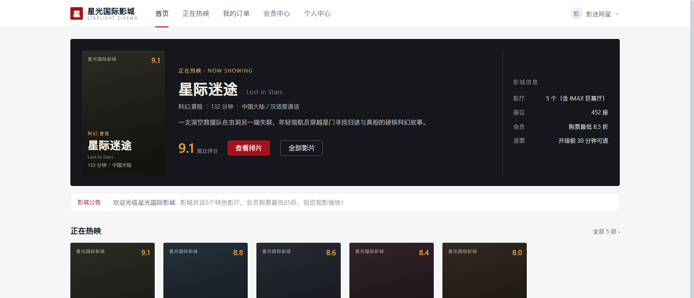
</p>

<p align="center">
  
  
  
  
  
  
  
  
  
  
  
  
  
</p>

---

## 📖 目录

1. [项目简介](#一项目简介)
2. [功能特性](#二功能特性)
3. [技术栈](#三技术栈)
4. [目录结构](#四目录结构)
5. [快速开始](#五快速开始)
6. [账号信息归档](#六账号信息归档)
7. [数据库设计](#七数据库设计)
8. [接口文档](#八接口文档)
9. [核心业务规则](#九核心业务规则)
10. [演示脚本](#十演示脚本)
11. [界面预览](#十一界面预览)
12. [部署与运维](#十二部署与运维)
13. [常见问题](#十三常见问题)
14. [更新日志](#十四更新日志)
15. [开源协议](#十五开源协议)

> 本文档是项目唯一的完整文档，已合并原 `docs/` 下的快速开始、演示说明、部署指南、接口文档、常见问题及历史教程中的有效内容。在线接口文档：启动后端后访问 <http://localhost:8080/api/swagger-ui/index.html>。

---

## 一、项目简介

**星光国际影城 CMS** 是一套面向中小影院的**全栈票务管理系统**，采用前后端分离架构，以「用户购票 → 员工检票 → 管理员运营」为主线，覆盖影院日常经营的完整闭环：

- **在线选座购票**：场次排期、可视化选座、座位锁、模拟支付、超时自动取消
- **会员体系**：等级折扣（普通 / 银卡 9 折 / 金卡 85 折）、积分累计、余额支付
- **员工检票**：票码核销、订单查询、会员开卡与充值
- **运营管理**：影片 / 影厅 / 排片 / 订单 / 用户 / 会员 / 公告 / 数据大屏

项目采用单体后端 + 三端合一的 Vite 前端工程（Hash 路由按角色分流），内置企业级日志审计、接口文档、健康监控、容器化部署与 CI 流水线，适合作为**全栈学习、课程设计、毕业设计与企业级工程实践**的参考项目。

**核心业务闭环**

```
管理员配置影片/影厅/排片 → 用户选座下单（锁座 15 分钟）→ 模拟支付
   → 订单生效 → 员工检票核销 → 订单完成（积分/会员成长）
   ↘ 超时未支付：定时任务自动取消并释放座位
```

---

## 二、功能特性

### 🎫 用户端（顾客）

| 模块 | 能力 |
|---|---|
| 首页 | 热映影片推荐、待映预告、公告轮播、快速选片 |
| 影片 | 影片列表（分类/关键词/分页）、影片详情（简介、演职人员、评分） |
| 选座购票 | 按日期/影厅筛选场次，可视化座位图，已售/锁定/维修座实时区分 |
| 下单支付 | 单笔最多 6 张，Redis 座位锁 15 分钟，模拟微信/支付宝/会员余额支付 |
| 订单中心 | 待支付/已支付/已退票/已取消/已完成全状态查询，超时订单自动取消 |
| 会员中心 | 会员等级与折扣、积分、余额、消费记录，在线开卡 |
| 个人中心 | 资料修改、密码修改 |
| 互动 | 公告查看、收藏式浏览体验、移动端自适应 |

### 🧑‍💼 员工端（检票 / 前台）

| 模块 | 能力 |
|---|---|
| 工作台 | 今日订单、待检票、票房概览 |
| 检票核销 | 输入订单号/票码核销，重复核销与异常票拦截并留痕 |
| 场次查询 | 按日期/影厅/影片查询排片与上座情况 |
| 订单查询 | 全状态订单检索，辅助退票与异常处理 |
| 会员办理 | 开卡、充值、积分与等级查询 |

### 🛠️ 管理端（运营）

| 模块 | 能力 |
|---|---|
| 数据大屏 | 票房、订单、会员、上座率等多维统计（ECharts） |
| 影片管理 | 影片增删改查、上下架、海报上传、评分与简介维护 |
| 影厅管理 | 影厅类型/座位数/票价配置（普通 / IMAX / VIP / 儿童厅） |
| 排片管理 | 按影厅与时段排片，冲突校验、票价与语言版本设置 |
| 订单管理 | 全量订单查询、状态流转、退票处理 |
| 用户管理 | 员工/顾客账号管理、角色分配、启禁用 |
| 会员管理 | 会员等级规则、积分与余额调整 |
| 公告管理 | 系统通知/活动公告发布、草稿与上下线 |

### 🏗️ 平台级能力

- **统一响应与异常**：`{code, message, data}` 标准返回，常见异常统一处理
- **JWT 认证 + Redis 会话**：登出即失效，支持主动下线；连续 5 次登录失败锁定 10 分钟
- **企业级日志**：三通道滚动日志（业务 / 错误 / 审计），TraceId 全链路追踪
- **操作审计**：AOP 自动记录写操作（操作人、IP、模块、参数、耗时），敏感字段脱敏
- **在线接口文档**：SpringDoc / OpenAPI 3，支持 Bearer Token 直接调试
- **健康监控**：Actuator + Prometheus 指标暴露，Docker 健康检查就绪
- **容器化交付**：后端多阶段镜像 + 前端 Nginx 镜像 + Docker Compose 一键编排
- **持续集成**：GitHub Actions 自动执行测试、前端构建与镜像冒烟

---

## 三、技术栈

### 后端

| 技术 | 版本 | 说明 |
|---|---|---|
| Spring Boot | 2.7.18 | 基础框架（Web / Validation / AOP / Actuator） |
| Java | 17 | 运行时（LTS） |
| MyBatis-Plus | 3.5.5 | ORM、逻辑删除、乐观锁、分页插件 |
| MySQL Connector/J | 8.0.33 | 由 Spring Boot BOM 管理 |
| JJWT | 0.11.5 | JWT 签发与校验 |
| Spring Security Crypto | 5.7.11 | BCrypt 密码加密（仅加密模块） |
| Hutool | 5.8.25 | 工具库（ID、日期、加密辅助） |
| SpringDoc OpenAPI | 1.7.0 | Swagger UI / OpenAPI 3 文档 |
| Micrometer Prometheus | BOM 管理 | 指标采集 |
| Lombok | BOM 管理 | 简化实体代码 |
| JUnit Jupiter / Mockito | 5.8.2 / 4.5.1 | 单元测试（37 用例） |

### 前端（三端合一工程）

| 技术 | 版本 | 说明 |
|---|---|---|
| Vue | 3.4.27 | 组合式 API |
| Vite | 5.2.11 | 构建工具（开发 5173） |
| Vue Router | 4.3.2 | Hash 路由 + 角色守卫 |
| Pinia | 2.1.7 | 状态管理（登录态持久化） |
| Element Plus | 2.7.6 | UI 组件库 |
| @element-plus/icons-vue | 2.3.x | 图标 |
| Axios | 1.6.8 | HTTP 客户端（统一拦截器） |
| ECharts | 5.5.0 | 数据大屏图表 |

### 数据库与中间件

| 技术 | 版本 | 说明 |
|---|---|---|
| MySQL | 8.0 | 主数据库（15 张表，utf8mb4） |
| Redis | 7（容器）/ 5+（本机） | 登录令牌、座位锁、登录防爆破 |

### 开发与运维工具

| 工具 | 版本 | 说明 |
|---|---|---|
| Maven | 3.9+ | 后端构建 |
| Node.js | 20+ | 前端构建（推荐 20 LTS） |
| ESLint | 9.39.4 | Flat Config 代码检查 |
| Prettier | 3.9.10 | 代码格式化 |
| Docker / Compose | 24+ | 容器化部署（可选） |
| GitHub Actions | — | CI：测试 + 构建 + 镜像冒烟 |

---

## 四、目录结构

```
CMS/
├─ backend/                        # Spring Boot 后端
│  ├─ src/main/java/com/starlight/cms/
│  │  ├─ aspect/                   # 操作审计切面
│  │  ├─ common/                   # Result / PageResult / 常量 / 基类
│  │  ├─ config/                   # WebMvc / Redis / MyBatis / OpenAPI / TraceId
│  │  ├─ controller/
│  │  │  ├─ common/                # 登录、文件上传
│  │  │  ├─ app/                   # 用户端接口
│  │  │  ├─ staff/                 # 员工端接口
│  │  │  └─ admin/                 # 管理端接口
│  │  ├─ dto/  vo/  entity/        # 数据传输 / 视图 / 实体
│  │  ├─ exception/                # 业务异常与全局处理
│  │  ├─ mapper/                   # MyBatis-Plus Mapper
│  │  ├─ security/                 # JWT、拦截器、上下文、权限工具
│  │  ├─ service/                  # 业务服务（接口 + 实现）
│  │  └─ util/                     # Redis 服务（含分布式锁）
│  ├─ src/main/resources/
│  │  ├─ application.yml           # 主配置（环境变量外置）
│  │  └─ logback-spring.xml        # 三通道日志
│  ├─ src/test/java/               # JUnit5 + Mockito 单元测试
│  └─ Dockerfile
├─ frontend/                       # Vue 3 三端合一前端
│  ├─ src/views/app|staff|admin/   # 三类角色页面
│  ├─ src/layout/                  # 三套布局
│  ├─ src/api|store|router|utils/  # 接口、状态、路由、请求封装
│  ├─ eslint.config.mjs            # ESLint 9 Flat Config
│  ├─ .prettierrc.json
│  ├─ Dockerfile / nginx-default.conf
│  └─ vite.config.js
├─ sql/cms.sql                     # 建库脚本（15 表 + 种子数据）
├─ uploads/                        # 上传文件（海报）
├─ assets/screenshots/             # 界面预览截图（cover + 12 张页面实拍）
├─ .github/workflows/ci.yml        # CI 流水线
├─ docker-compose.yml              # MySQL + Redis + 后端 + 前端
├─ .env.example                    # 环境变量模板
├─ start-all.bat / stop-all.bat    # Windows 一键启动 / 停止
└─ README.md                       # 项目完整文档（本文件）
```

---

## 五、快速开始

> 目标：从零把项目跑起来。

### 5.1 环境要求

| 软件 | 版本要求 | 检查命令 | 说明 |
|---|---|---|---|
| JDK | 17+ | `java -version` | 后端运行 |
| Maven | 3.6+ | `mvn -v` | 后端构建 |
| Node.js | 18+（推荐 20 LTS） | `node -v` | 前端构建 |
| npm | 9+ | `npm -v` | 前端依赖 |
| MySQL | 8.0 | `mysql --version` | 端口 3306 |
| Redis | 5.0+ | `redis-cli ping` | 端口 6379，返回 `PONG` |

### 5.2 端口与数据规划

| 服务 | 端口 | 说明 |
|---|---|---|
| 后端 API | 8080 | 上下文路径 `/api` |
| 前端开发服务器 | 5173 | 三端共用入口 |
| MySQL | 3306 | 库名 `cms` |
| Redis | 6379 | 无密码（本地） |

> 启动前确认端口空闲：`netstat -ano | findstr ":8080 :5173"`

### 5.3 初始化数据库

```bash
# 在项目根目录执行（Windows PowerShell / CMD 均可）
mysql -u root -p123456 < sql/cms.sql
```

脚本行为：先 `DROP DATABASE IF EXISTS cms` 再重建，**会清空已有数据**，请勿在生产库直接执行。

初始化内容：

| 数据 | 数量 |
|---|---|
| 用户 / 角色 | 6 用户 / 3 角色 |
| 影厅 / 座位 | 5 影厅 / 452 座位 |
| 影片 / 排片 | 8 影片 / 180 排片（近 9 天） |
| 会员等级 | 3 级（普通 / 银卡 / 金卡） |
| 公告 | 3 条 |

验证：

```sql
USE cms;
SELECT COUNT(*) FROM sys_user;      -- 6
SELECT COUNT(*) FROM biz_movie;     -- 8
SELECT COUNT(*) FROM biz_schedule;  -- 180
SELECT COUNT(*) FROM biz_seat;      -- 452
```

> 种子密码以 `PLAIN:` 前缀明文入库，后端首次启动时由 `DataInitializer` 自动转换为 BCrypt，属正常设计。

### 5.4 准备 Redis

```bash
redis-server          # 或 Windows 下双击 redis-server.exe
redis-cli ping        # 期望 PONG
```

本地开发 Redis 无密码；若设置了密码，通过环境变量 `REDIS_PASSWORD` 传入。

### 5.5 启动后端

```bash
cd backend
mvn spring-boot:run
```

成功标志：

```
Started CmsApplication in x.x seconds
========== 星光国际影城 CMS 启动成功！http://localhost:8080/api ==========
```

生产运行：

```bash
mvn clean package -DskipTests
java -jar target/cms-server.jar
```

### 5.6 启动前端

```bash
cd frontend
npm install        # 首次
npm run dev
```

浏览器访问 <http://localhost:5173>。三端共用同一工程，登录后按角色自动进入对应工作台。

前端脚本：

| 命令 | 作用 |
|---|---|
| `npm run dev` | 开发服务器（5173，自动打开浏览器） |
| `npm run build` | 生产构建（输出 `dist/`） |
| `npm run preview` | 预览构建产物 |
| `npm run lint` | ESLint 自动修复 |
| `npm run lint:check` | ESLint 只检查（CI 使用） |
| `npm run format` | Prettier 格式化 `src/**` |

### 5.7 环境变量

| 变量 | 默认值 | 说明 |
|---|---|---|
| `SERVER_PORT` | 8080 | 服务端口 |
| `DB_HOST` / `DB_PORT` | localhost / 3306 | MySQL 地址 |
| `DB_NAME` | cms | 数据库名 |
| `DB_USERNAME` / `DB_PASSWORD` | root / 123456 | 数据库账号 |
| `REDIS_HOST` / `REDIS_PORT` | localhost / 6379 | Redis 地址 |
| `REDIS_PASSWORD` | 空 | Redis 密码 |
| `JWT_SECRET` | 内置开发密钥 | **生产必须更换**（≥32 位） |
| `JWT_EXPIRE` | 86400000 | Token 有效期（毫秒，24h） |
| `FILE_UPLOAD_PATH` | `F:/AI_full-stack_project/CMS/uploads/` | 上传目录，**迁移必改** |
| `SPRINGDOC_ENABLED` | true | 生产建议 false |

Windows 永久设置（重开终端生效）：

```bat
setx JWT_SECRET "请替换为32位以上随机字符串"
setx DB_PASSWORD "你的数据库密码"
setx FILE_UPLOAD_PATH "D:/cms/uploads/"
```

> `setx` 只对新开的终端生效；已运行的后端不会重读，修改后需重启进程。

### 5.8 Windows 一键启动（可选）

```bat
start-all.bat     :: 自动检查 MySQL/Redis → 启动后端 → 启动前端
stop-all.bat      :: 仅停止 8080/5173，保留 MySQL/Redis
```

> 脚本中的 MySQL/Redis 安装路径为作者本机路径，迁移后请按实际安装位置修改 `start-all.bat`。

### 5.9 启动验证清单

| # | 检查项 | 方式 | 预期 |
|---|---|---|---|
| 1 | 健康检查 | `GET http://localhost:8080/api/actuator/health` | `{"status":"UP"}` |
| 2 | 公开接口 | `GET /api/app/movie/list?current=1&size=3` | `code=200`，`total=8` |
| 3 | 登录 | `POST /api/auth/login` | `code=200`，返回 token 与角色 |
| 4 | 鉴权 | 不带 token 请求 `GET /api/auth/info` | HTTP **401** + `{"code":401}` |
| 5 | 接口文档 | <http://localhost:8080/api/swagger-ui/index.html> | Swagger UI 正常 |
| 6 | 前端 | <http://localhost:5173> | 首页加载 8 部影片 |
| 7 | 单元测试 | `cd backend && mvn test` | `Tests run: 37, Failures: 0` |
| 8 | 前端检查 | `cd frontend && npm run lint:check && npm run build` | 0 error，构建成功 |

一键验证登录（PowerShell）：

```powershell
Invoke-RestMethod "http://localhost:8080/api/auth/login" -Method Post `
  -ContentType "application/json" `
  -Body '{"username":"admin","password":"admin123"}'
```

---

## 六、账号信息归档

> 本节是项目所有账号的统一归档位置。**登录页面已移除演示账号明文提示**，请从本文档查阅；正式部署前必须修改全部密码并更换 `JWT_SECRET`。

### 6.1 应用账号（种子数据）

| 角色 | 账号 | 密码 | 昵称 | 入口 | 说明 |
|---|---|---|---|---|---|
| 超级管理员 | `admin` | `admin123` | 超级管理员 | 管理后台 `/admin/dashboard` | 全部管理权限，内置 `id=1` 不可删除 |
| 员工 | `staff01` | `123456` | 检票员小王 | 员工工作台 `/staff/dashboard` | 检票 / 会员办理 |
| 员工 | `staff02` | `123456` | 值班李经理 | 员工工作台 `/staff/dashboard` | 同上 |
| 金卡会员 | `user01` | `123456` | 影迷阿星 | 用户端 `/app/home` | 2380 积分 / 余额 128.50 / 85 折 |
| 银卡会员 | `user02` | `123456` | 小美 | 用户端 `/app/home` | 660 积分 / 9 折 |
| 普通用户 | `user03` | `123456` | 路人甲 | 用户端 `/app/home` | 未开卡 |

账号与角色的绑定关系：`admin → ROLE_ADMIN`，`staff01/staff02 → ROLE_STAFF`，`user01/user02/user03 → ROLE_USER`。

### 6.2 基础设施账号

| 组件 | 账号 | 密码 | 说明 |
|---|---|---|---|
| MySQL | `root` | `123456` | 本地开发默认值，可通过 `DB_USERNAME` / `DB_PASSWORD` 覆盖 |
| Redis | 无 | 空 | 本地开发无密码，可通过 `REDIS_PASSWORD` 设置 |
| JWT 密钥 | — | `starlight-cms-secret-key-2026-please-change-in-prod-0123456789` | 内置开发密钥，生产必须通过 `JWT_SECRET` 更换 |

### 6.3 账号安全说明

- 种子数据中的密码仅用于本地演示，**上线前必须在「用户管理」中逐个重置**。
- 同一账号连续输错 5 次密码会锁定 10 分钟，手动解锁：
  `redis-cli DEL cms:login:lock:<用户名>`、`redis-cli DEL cms:login:fail:<用户名>`。
- 新建用户时管理端默认初始密码为 `123456`，创建后应立即重置。
- 前端登录页不再展示任何账号或密码提示，账号信息仅保存在本文档中。

---

## 七、数据库设计

数据库 `cms`（utf8mb4），共 15 张表：

| 分类 | 表名 | 说明 |
|---|---|---|
| 系统 | `sys_user` | 用户（顾客 / 员工 / 管理员） |
| 系统 | `sys_role` | 角色（用户 / 员工 / 管理员） |
| 系统 | `sys_user_role` | 用户-角色关联 |
| 系统 | `sys_menu` | 菜单与权限标识 |
| 影院 | `biz_hall` | 影厅（普通 / 巨幕 / VIP / 儿童） |
| 影院 | `biz_seat` | 物理座位（行、列、类型、维修状态） |
| 内容 | `biz_movie` | 影片（热映 / 待映 / 下架） |
| 内容 | `biz_notice` | 公告（草稿 / 发布） |
| 排片 | `biz_schedule` | 场次（开场/散场、票价、语言版本、乐观锁） |
| 交易 | `biz_order` | 订单（状态、金额、支付、超时） |
| 交易 | `biz_order_seat` | 订单座位快照 |
| 会员 | `biz_member_level` | 会员等级（门槛积分、折扣） |
| 会员 | `biz_member` | 会员（积分、余额、累计消费、等级） |
| 检票 | `biz_ticket_check` | 检票核销记录（成功/失败留痕） |
| 统计 | `biz_stat_daily` | 每日票房统计 |

关键设计：

- 所有业务表含 `create_time / update_time`，需要软删除的表含 `is_deleted`（0 正常 / 1 删除）。
- `biz_schedule` 含 `version` 乐观锁字段，避免并发修改排片冲突。
- `biz_order` 的 `order_status`：0 待支付、1 已支付、2 已退票、3 已取消、4 已完成。
- 座位分为普通 / 优选 / VIP / 亲子，`biz_seat.status`：1 正常、0 维修。
- 会员等级：普通 0 分、银卡 500 分（9 折）、金卡 2000 分（85 折）。

---

## 八、接口文档

> REST API v1.1.0。在线调试：<http://localhost:8080/api/swagger-ui/index.html>

### 8.1 基础信息

| 项目 | 说明 |
|---|---|
| 基础地址 | `http://localhost:8080/api` |
| 数据格式 | `application/json; charset=UTF-8`（上传为 `multipart/form-data`） |
| 认证方式 | 请求头 `Authorization: Bearer <token>` |
| 时间格式 | `yyyy-MM-dd HH:mm:ss`（Asia/Shanghai） |
| 日期参数 | `yyyy-MM-dd` |
| 字符编码 | UTF-8 |

统一响应：

```json
{ "code": 200, "message": "操作成功", "data": {} }
```

| 字段 | 类型 | 说明 |
|---|---|---|
| `code` | int | 200 成功，其他为错误码 |
| `message` | string | 提示信息 |
| `data` | any | 业务数据，可为 null / 对象 / 数组 |

分页参数与返回：请求参数统一为 **`current`**（页码，默认 1）与 **`size`**（每页条数，默认 10）。

```json
{
  "code": 200,
  "message": "操作成功",
  "data": {
    "records": [],
    "total": 180,
    "size": 10,
    "current": 1,
    "pages": 18
  }
}
```

错误码：

| code | HTTP | 含义 |
|---|---|---|
| 200 | 200 | 成功 |
| 400 | 200 | 参数错误（校验失败、类型错误、缺少参数、上传超限） |
| 401 | **401** | 未登录 / Token 无效或过期 |
| 403 | 200 | 无权限（角色不足或越权操作） |
| 404 | 200 | 资源不存在 |
| 500 | 200 | 业务失败 / 系统内部错误 |
| 1001 | 200 | 账号或密码错误 |
| 1002 | 200 | 账号锁定（连续失败 5 次，锁 10 分钟） |
| 1003 | 200 | 账号已被禁用 |
| 1004 | 200 | 账号已存在（注册冲突） |

> 除 401 使用真实 HTTP 状态码外，其余业务错误 HTTP 状态仍为 200，需以 `code` 判断。

角色与权限：

| 角色 | 编码 | 权限范围 |
|---|---|---|
| 普通用户 | `ROLE_USER` | 浏览、下单支付、会员、订单查询 |
| 员工 | `ROLE_STAFF` | 用户端全部 + 检票、订单/场次查询、会员办理、上传 |
| 管理员 | `ROLE_ADMIN` | 全部权限（含员工端） |

免登录白名单：

```
/auth/login、/auth/register、/upload/**、
/app/movie/list、/app/movie/detail/**、/app/movie/hot、
/app/notice/list、/app/schedule/**、
/v3/api-docs/**、/swagger-ui/**、/swagger-ui.html、/actuator/**
```

### 8.2 认证 `/auth`

| 方法 | 路径 | 权限 | 说明 |
|---|---|---|---|
| POST | `/auth/login` | 公开 | 登录，返回 JWT 与角色 |
| POST | `/auth/register` | 公开 | 注册（固定普通用户角色） |
| GET | `/auth/info` | 登录 | 当前用户信息 + 角色编码 |
| POST | `/auth/logout` | 登录 | 退出（删除 Redis 会话，Token 立即失效） |

登录：

`POST /auth/login`

```json
{ "username": "admin", "password": "admin123" }
```

```json
{
  "code": 200,
  "message": "登录成功",
  "data": {
    "token": "eyJhbGciOiJIUzI1NiJ9...",
    "userId": 1,
    "username": "admin",
    "nickname": "超级管理员",
    "avatar": null,
    "roles": ["ROLE_ADMIN"],
    "primaryRole": "ROLE_ADMIN"
  }
}
```

规则：同一账号连续失败 5 次锁定 10 分钟；账号不存在与密码错误统一提示。

注册：

`POST /auth/register`

| 字段 | 类型 | 必填 | 规则 |
|---|---|---|---|
| `username` | string | 是 | 4~20 位 |
| `password` | string | 是 | 6~20 位 |
| `nickname` | string | 否 | 缺省取用户名 |
| `phone` | string | 否 | 手机号格式 |

### 8.3 文件上传 `/file`

| 方法 | 路径 | 权限 | 说明 |
|---|---|---|---|
| POST | `/file/upload` | 员工/管理员 | 上传图片，返回访问地址 |

- 表单字段名：**`file`**（`multipart/form-data`）
- 类型：`jpg / jpeg / png / gif / webp`，并做 MIME 二次校验（防改后缀）
- 大小：单文件 ≤ **10MB**，单次请求 ≤ 20MB
- 返回：

```json
{ "code": 200, "message": "上传成功", "data": { "url": "/upload/9f2c....jpg", "fileName": "9f2c....jpg" } }
```

> 访问时需加 `/api` 前缀：`http://localhost:8080/api/upload/9f2c....jpg`。

### 8.4 电影

用户端 `/app/movie`：

| 方法 | 路径 | 权限 | 说明 | 参数 |
|---|---|---|---|---|
| GET | `/app/movie/list` | 公开 | 影片分页（评分降序） | `current`, `size`, `movieStatus`, `keyword` |
| GET | `/app/movie/detail/{id}` | 公开 | 影片详情 | path `id` |
| GET | `/app/movie/hot` | 公开 | 热映前 6（Redis 缓存 30 分钟） | — |

管理端 `/admin/movie`：

| 方法 | 路径 | 权限 | 说明 | 参数 |
|---|---|---|---|---|
| GET | `/admin/movie/page` | 管理员 | 影片分页 | `current`, `size`, `keyword`, `movieStatus` |
| GET | `/admin/movie/all` | 管理员 | 全部影片（排片下拉） | — |
| GET | `/admin/movie/{id}` | 管理员 | 影片详情 | path `id` |
| POST | `/admin/movie/save` | 管理员 | 新增/修改（有 id 即修改），清热映缓存 | body 实体 |
| DELETE | `/admin/movie/{id}` | 管理员 | 删除影片 | path `id` |

### 8.5 场次与选座

| 方法 | 路径 | 权限 | 说明 | 参数 |
|---|---|---|---|---|
| GET | `/app/schedule/movie/{movieId}` | 公开 | 某影片场次（可按日期） | path `movieId`；`date` |
| GET | `/app/schedule/{id}` | 公开 | 场次详情 | path `id` |
| GET | `/app/schedule/seat/{scheduleId}` | 公开 | 座位图（含已售状态） | path `scheduleId` |
| GET | `/staff/schedule/page` | 员工 | 员工端场次分页 | `current`, `size`, `movieId`, `hallId`, `keyword`, `date` |
| GET | `/staff/schedule/{id}` | 员工 | 场次详情 | path `id` |
| GET | `/admin/schedule/page` | 管理员 | 排片分页 | `current`, `size`, `movieId`, `hallId`, `keyword`, `date` |
| POST | `/admin/schedule/save` | 管理员 | 新增/修改排片（自动算散场、校验冲突） | body 实体 |
| POST | `/admin/schedule/cancel/{id}` | 管理员 | 取消场次（status=0） | path `id` |
| DELETE | `/admin/schedule/{id}` | 管理员 | 删除场次 | path `id` |
| GET | `/admin/schedule/seat/{scheduleId}` | 管理员 | 场次座位售卖情况 | path `scheduleId` |

座位图返回示例（`SeatVO`）：

```json
{ "id": 12, "rowNum": 3, "colNum": 5, "seatName": "3排5座", "status": 1, "sold": false }
```

> `status`：0 维修/不可用，1 正常；`sold` 表示该场次已售或锁定。

### 8.6 订单交易

用户端 `/app/order`（均需登录）：

| 方法 | 路径 | 说明 | 参数 |
|---|---|---|---|
| POST | `/app/order/create` | 创建订单并锁座（15 分钟内支付） | body `{ scheduleId, seatIds: [] }` |
| POST | `/app/order/pay` | 模拟支付 | body `{ orderNo, payType }` |
| POST | `/app/order/cancel/{orderNo}` | 取消待支付订单（释放座位） | path |
| POST | `/app/order/refund/{orderNo}` | 退票（释放座位） | path |
| GET | `/app/order/mine` | 我的订单分页 | `status`, `current`, `size` |
| GET | `/app/order/{id}` | 订单详情（归属校验） | path |

员工 / 管理端：

| 方法 | 路径 | 权限 | 说明 | 参数 |
|---|---|---|---|---|
| GET | `/staff/order/page` | 员工 | 订单分页查询 | `current`, `size`, `orderNo`, `status`, `scheduleId` |
| GET | `/staff/order/{id}` | 员工 | 订单详情 | path |
| GET | `/admin/order/page` | 管理员 | 订单分页查询 | 同上 |
| GET | `/admin/order/{id}` | 管理员 | 订单详情 | path |

下单示例：

```json
{ "scheduleId": 10, "seatIds": [101, 102] }
```

```json
{
  "code": 200,
  "message": "下单成功，请在15分钟内完成支付",
  "data": {
    "orderNo": "202610232145300001",
    "totalAmount": 110.00,
    "orderStatus": 0,
    "expireTime": "2026-10-23 22:00:30",
    "seats": ["5排6座", "5排7座"]
  }
}
```

支付：`POST /app/order/pay`，`payType` `1` 微信、`2` 支付宝、`3` 会员余额（余额不足时返回 500 业务提示）。

订单状态：

| orderStatus | 含义 |
|---|---|
| 0 | 待支付（超时自动取消） |
| 1 | 已支付 |
| 2 | 已退票 |
| 3 | 已取消（超时/主动） |
| 4 | 已完成（已检票） |

### 8.7 公告

| 方法 | 路径 | 权限 | 说明 | 参数 |
|---|---|---|---|---|
| GET | `/app/notice/list` | 公开 | 已发布公告（Redis 缓存 10 分钟） | — |
| GET | `/admin/notice/page` | 管理员 | 公告分页 | `current`, `size` |
| POST | `/admin/notice/save` | 管理员 | 新增/修改；发布时自动补发布时间 | body 实体 |
| DELETE | `/admin/notice/{id}` | 管理员 | 删除并清缓存 | path |

### 8.8 会员

用户端 `/app/member`（需登录）：

| 方法 | 路径 | 说明 | 参数 |
|---|---|---|---|
| GET | `/app/member/center` | 会员中心（余额/等级/积分/消费） | — |
| POST | `/app/member/open` | 开通会员 | — |
| POST | `/app/member/recharge` | 模拟充值 | query `amount`（无请求体） |
| GET | `/app/member/levels` | 会员等级列表 | — |

员工端 `/staff/member`：

| 方法 | 路径 | 说明 | 参数 |
|---|---|---|---|
| GET | `/staff/member/search-user` | 按账号/昵称/手机号搜索（限 20 条） | query `keyword`（必填） |
| POST | `/staff/member/open/{userId}` | 为指定用户开卡 | path `userId` |
| POST | `/staff/member/recharge` | 为指定用户充值 | query `userId`, `amount` |
| GET | `/staff/member/page` | 会员分页 | `current`, `size`, `keyword` |

管理端 `/admin/member`：

| 方法 | 路径 | 说明 | 参数 |
|---|---|---|---|
| GET | `/admin/member/page` | 会员分页（只读） | `current`, `size`, `keyword` |

会员等级：

| 等级 | 门槛积分 | 折扣 |
|---|---|---|
| 普通会员 | 0 | 无 |
| 银卡会员 | 500 | 9 折 |
| 金卡会员 | 2000 | 85 折 |

### 8.9 检票核销 `/staff/check`

| 方法 | 路径 | 权限 | 说明 | 参数 |
|---|---|---|---|---|
| POST | `/staff/check/scan/{orderNo}` | 员工 | 核销检票，记录核销人与时间 | path `orderNo` |
| GET | `/staff/check/records` | 员工 | 最近 50 条核销记录（含订单号） | — |

核销返回示例：

```json
{ "code": 200, "data": { "orderNo": "202610230001", "movieName": "星际迷途", "seatInfo": "5排6座", "checkTime": "2026-10-23 19:30:00" } }
```

失败场景：订单未支付、重复核销、场次不符等，均返回业务错误并写入 `biz_ticket_check`（result=0）。

### 8.10 员工工作台 `/staff/dashboard`

| 方法 | 路径 | 权限 | 说明 |
|---|---|---|---|
| GET | `/staff/dashboard/overview` | 员工 | 今日订单/票房/待检票/待开场场次 |

### 8.11 用户与角色 `/admin/user`

| 方法 | 路径 | 说明 | 参数 |
|---|---|---|---|
| GET | `/admin/user/page` | 用户分页（密码置空） | `current`, `size`, `keyword` |
| GET | `/admin/user/roles` | 角色列表 | — |
| GET | `/admin/user/role-codes/{userId}` | 用户角色编码 | path |
| POST | `/admin/user/save` | 新增用户/员工并绑角色 | body `{username,password,nickname,realName,phone,gender,roleId}` |
| POST | `/admin/user/status` | 启用/禁用 | query `id`, `status`（1 启用 / 0 禁用） |
| POST | `/admin/user/reset-pwd` | 重置密码 | query `id`, `password` |
| DELETE | `/admin/user/{id}` | 删除用户（内置超管 id=1 不可删） | path |

### 8.12 票房统计 `/admin/stat`

| 方法 | 路径 | 说明 | 参数 |
|---|---|---|---|
| GET | `/admin/stat/overview` | 核心经营指标 | — |
| GET | `/admin/stat/movie-rank` | 影片票房排行 | — |
| GET | `/admin/stat/trend` | 近 N 天票房趋势 | query `days`（默认 7） |

### 8.13 影厅与座位 `/admin/hall`

| 方法 | 路径 | 说明 | 参数 |
|---|---|---|---|
| GET | `/admin/hall/list` | 影厅列表 | — |
| POST | `/admin/hall/save` | 新增/修改影厅（seatCount = 行 × 列，自动重建座位） | body 实体 |
| GET | `/admin/hall/seats/{hallId}` | 座位矩阵 | path |
| POST | `/admin/hall/seat/update` | 修改座位（如设为维修） | body `{id,status}` |
| DELETE | `/admin/hall/{id}` | 删除影厅 | path |

### 8.14 Swagger 在线调试

1. 启动后端，访问 <http://localhost:8080/api/swagger-ui/index.html>
2. 调用 `POST /auth/login` 获取 token
3. 点击右上角 **Authorize**，填写 `Bearer <token>`
4. 即可调试所有受保护接口

生产环境建议关闭：`SPRINGDOC_ENABLED=false`。

### 8.15 调用示例（cURL）

```bash
# 1. 登录
curl -X POST http://localhost:8080/api/auth/login \
  -H "Content-Type: application/json" \
  -d '{"username":"admin","password":"admin123"}'

# 2. 带 token 查询当前用户
curl http://localhost:8080/api/auth/info \
  -H "Authorization: Bearer <token>"

# 3. 公开接口（免登录）
curl "http://localhost:8080/api/app/movie/list?current=1&size=3"

# 4. 健康检查
curl http://localhost:8080/api/actuator/health
```

---

## 九、核心业务规则

### 9.1 选座与防超卖

- 单笔订单最多 **6 张**票，座位 ID 去重后校验归属影厅与维修状态。
- 数据库层校验有效订单（已支付 / 已完成 / 未超时的待支付）是否占用座位。
- Redis `setnx` 原子锁座，key 为 `cms:seat:lock:<场次ID>:<座位ID>`，默认 **15 分钟**；任一座位抢锁失败会回滚本次已加的锁。
- 支付成功后释放 Redis 锁，以数据库已售状态为准。

### 9.2 订单与支付

- 订单号格式：`CG + yyyyMMddHHmmss + 4 位随机数`。
- 待支付订单超过 `expire_time` 后，定时任务每分钟扫描并自动取消、释放座位。
- 退票仅允许在**开场前 30 分钟以上**；余额支付原路退回，并扣回对应积分。
- 支付成功累计积分与消费金额，并按积分自动重算会员等级。

### 9.3 排片冲突校验

同一影厅时间重叠规则：`a.start < b.end && a.end > b.start`，首尾相接允许。散场时间 = 开场时间 + 片长 + 10 分钟清场，由后端统一计算。

### 9.4 检票核销

仅 `已支付(1)` 状态订单可核销，核销后订单变为 `已完成(4)`；其他状态写入 `biz_ticket_check`（result=0）并返回失败原因。

### 9.5 登录安全

- 登录成功：JWT 与 Redis 会话同时写入，登出删除 Redis key，使 Token 立即失效。
- 连续失败 5 次锁定 10 分钟；账号不存在与密码错误使用统一提示，避免账号枚举。
- 密码使用 BCrypt 加密存储，接口返回用户信息时忽略密码字段。

---

## 十、演示脚本

> 10 分钟走通三端，适合答辩、评审或快速试用。截图与本文「界面预览」一一对应。

### 10.1 演示前准备

| 项目 | 要求 |
|---|---|
| 服务 | `start-all.bat` 一键启动（MySQL → Redis → 后端 8080 → 前端 5173） |
| 入口 | <http://localhost:5173/#/login> |
| 数据 | `sql/cms.sql` 已导入（8 部影片 / 180 场排片） |
| 接口文档（可选） | <http://localhost:8080/api/swagger-ui/index.html> |

演示账号见[账号信息归档](#六账号信息归档)。

### 10.2 用户端（约 4 分钟）

1. **首页 `#/app/home`**：深色主推位、影城信息（5 厅 / 452 座 / 会员 8.5 折 / 开场前 30 分钟可退）、公告条、正在热映与即将上映分区。
2. **影片与排片 `#/app/movie/1`**：导演主演与评分 → 7 天日期条 → 选择日期查看场次（时间 / 影厅 / 散场时间 / 余票 / 价格）。
3. **选座购票 `#/app/seat/{id}`**：银幕弧形座位图，金卡「抢先选座」；单笔最多 6 张，可选 VIP 座、儿童座。选座后支付（微信 / 支付宝 / 会员余额）。
4. **订单中心 `#/app/orders`**：查看新订单；开场 30 分钟前可申请退票并原路退回。
5. **会员中心 `#/app/member`**：查看积分 / 累计消费 / 折扣 / 余额，演示充值后积分与折扣联动。

### 10.3 员工端（约 3 分钟）

1. **工作台 `#/staff/dashboard`**：当日票房 / 订单 / 出票 / 待开场地统计。
2. **检票核销 `#/staff/check`**：粘贴用户端产生的订单号 → 核销 → 查看结果卡与检票记录；重复核销会提示失败。
3. **场次 / 订单 / 会员查询**：按订单号查询购票信息、按日期查询排片、办理开卡与充值。

### 10.4 管理端（约 3 分钟）

1. **票房大盘 `#/admin/dashboard`**：总票房 / 总订单 / 总出票 / 注册用户 / 会员数 / 今日票房 + 近 7 天趋势 + 影片排行。
2. **内容管理**：电影、排片、订单、影厅与座位图、用户启禁用、会员、公告。
3. **三端联动收尾（可选）**：管理端新增排片 → 用户端可见新场次 → 员工端检票。

### 10.5 演示翻车预案

| 现象 | 处理 |
|---|---|
| 详情页今日无场次 | 点日期条「明天」或用管理端先补一场排片 |
| Token 过期（24h 后） | 退出重新登录 |
| 用户余额不足 | 会员中心先充值，或支付时选「模拟微信」 |
| 订单已开场不能购票 | 换未来一场（列表已自动隐藏已开场场次） |
| 登录被锁（连错 5 次） | `redis-cli DEL cms:login:lock:<用户名>` 解锁 |
| 想清空数据重新演示 | 重新导入 `sql/cms.sql`（会重置全部业务表） |

---

## 十一、界面预览

> 截图保存在 `assets/screenshots/`（1440×900 实际运行界面，基于 v1.1.0 默认演示数据拍摄）。

| 预览 | 文件 | 页面 | 登录账号 |
|---|---|---|---|
| 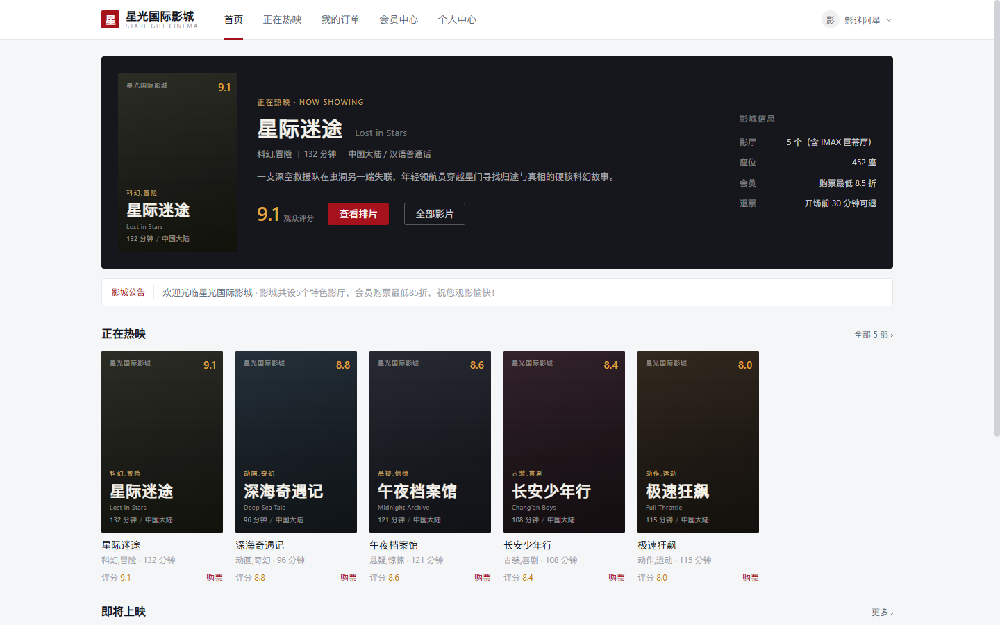 | `user-home.png` | 用户端 · 首页 | `user01` |
| 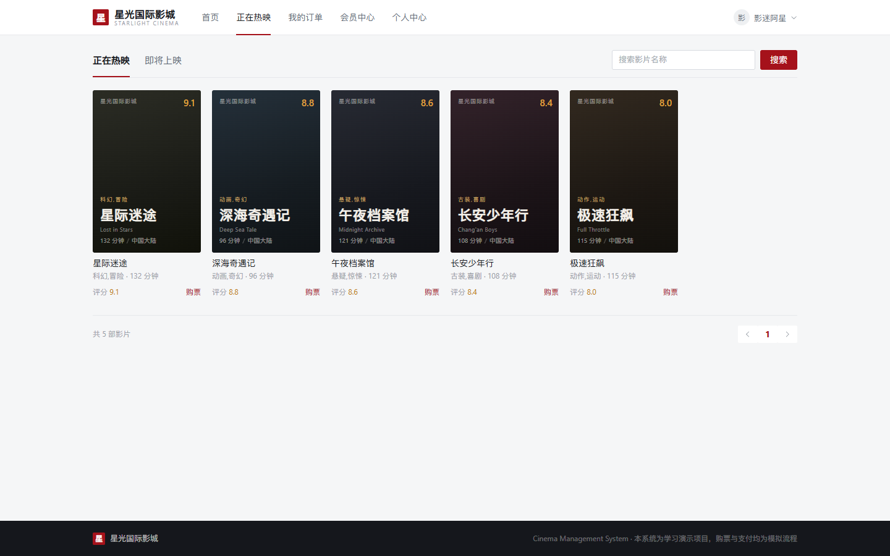 | `movie-list.png` | 用户端 · 影片列表 | `user01` |
| 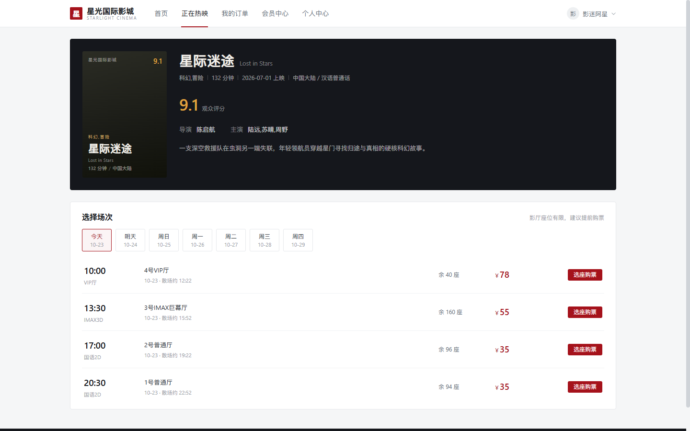 | `movie-detail.png` | 用户端 · 影片详情 | `user01` |
| 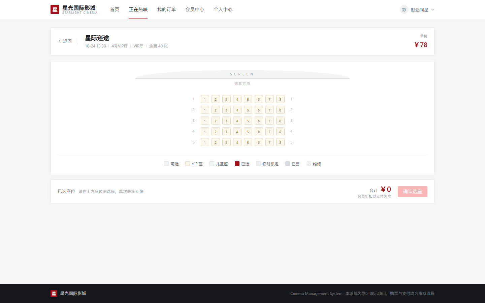 | `seat-select.png` | 用户端 · 在线选座 | `user01` |
| 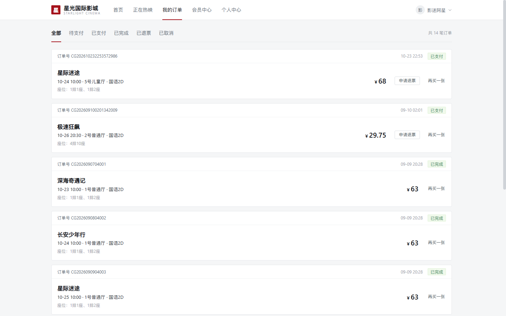 | `order-center.png` | 用户端 · 订单中心 | `user01` |
| 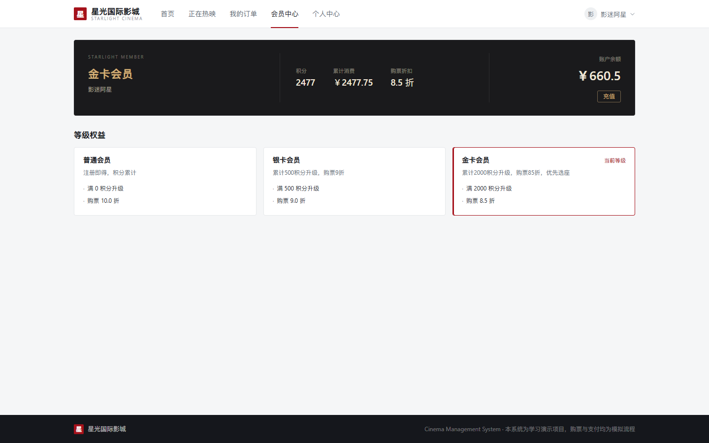 | `member-center.png` | 用户端 · 会员中心 | `user01` |
| 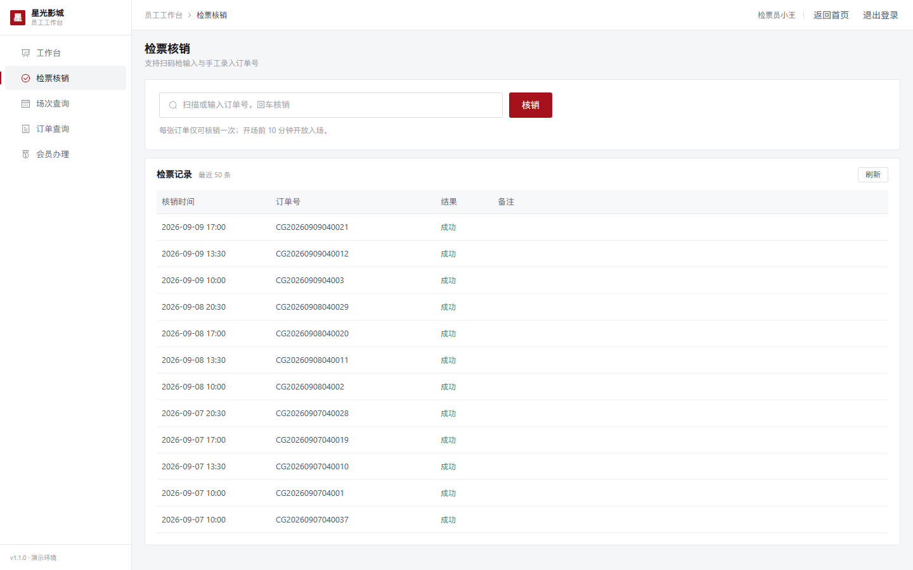 | `staff-check.png` | 员工端 · 检票核销 | `staff01` |
| 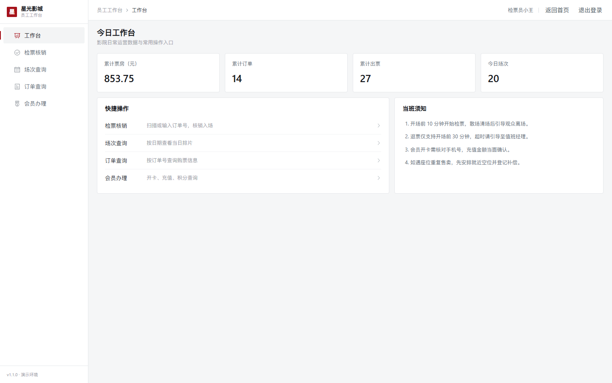 | `staff-dashboard.png` | 员工端 · 工作台 | `staff01` |
| 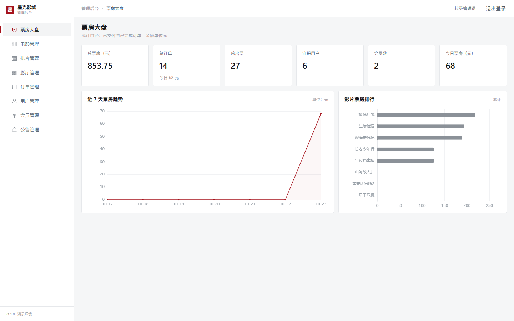 | `admin-dashboard.png` | 管理端 · 数据大屏 | `admin` |
| 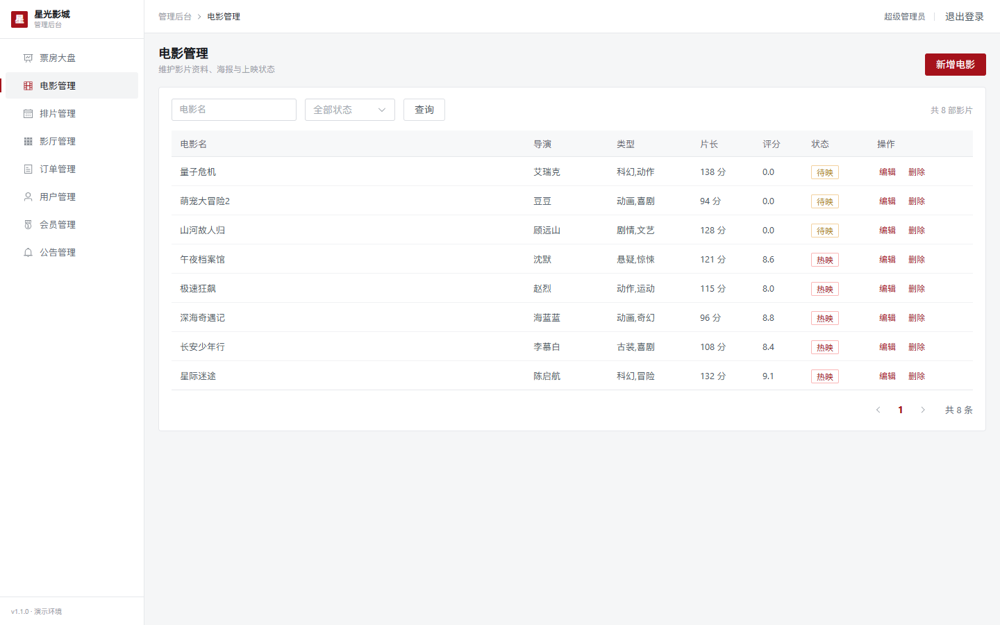 | `admin-movie-manage.png` | 管理端 · 影片管理 | `admin` |
| 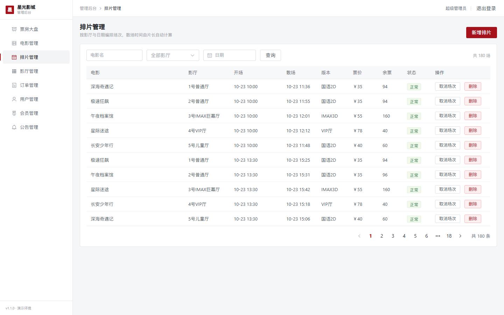 | `admin-schedule-manage.png` | 管理端 · 排片管理 | `admin` |
| 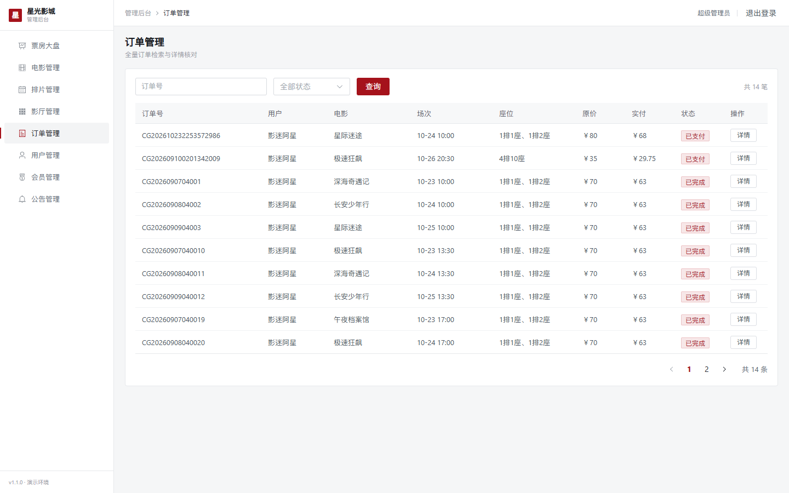 | `admin-order-manage.png` | 管理端 · 订单管理 | `admin` |

重拍要求：浏览器窗口 1440×900、PNG 格式、单张建议 < 500KB、使用种子数据且不出现真实隐私信息。

---

## 十二、部署与运维

### 12.1 部署架构

```
                     ┌────────────────────────────┐
  浏览器 ──────────► │  Nginx（前端静态资源 + 反代）│
                     └──────────┬─────────────────┘
                                │ /api/*
                     ┌──────────▼─────────────────┐
                     │  cms-server (:8080 /api)    │
                     │  Spring Boot 2.7 + Java 17  │
                     └──────┬──────────────┬───────┘
                            │              │
                   ┌────────▼────┐  ┌──────▼──────┐
                   │  MySQL 8.0  │  │   Redis     │
                   └─────────────┘  └─────────────┘
```

- 前端为 Hash 路由单页应用，**一个 Nginx 站点即可承载用户端 / 员工端 / 管理端**。
- 上传文件由后端 `/api/upload/**` 提供访问。

### 12.2 手动部署（单机）

**数据库**：

```bash
# 全新部署
mysql -u root -p < sql/cms.sql

# 已有数据：仅创建库与账号（切勿执行 cms.sql，会 DROP 库）
```

建议为应用创建独立账号：

```sql
CREATE USER 'cms'@'%' IDENTIFIED BY '强密码';
GRANT SELECT, INSERT, UPDATE, DELETE ON cms.* TO 'cms'@'%';
FLUSH PRIVILEGES;
```

**后端打包与运行**：

```bash
cd backend
mvn clean package -DskipTests
```

产物：`backend/target/cms-server.jar`（含内嵌 Tomcat）。

生产启动（环境变量必须外置）：

```bash
export SPRING_PROFILES_ACTIVE=prod
export DB_HOST=127.0.0.1
export DB_PORT=3306
export DB_NAME=cms
export DB_USERNAME=cms
export DB_PASSWORD='强密码'
export REDIS_HOST=127.0.0.1
export REDIS_PORT=6379
export JWT_SECRET='至少32位随机字符串'
export FILE_UPLOAD_PATH=/data/cms/uploads/
export SPRINGDOC_ENABLED=false

java -Xms512m -Xmx1g -jar cms-server.jar
```

**systemd 托管（Linux）**，`/etc/systemd/system/cms.service`：

```ini
[Unit]
Description=Starlight Cinema CMS
After=network.target mysql.service redis.service

[Service]
Type=simple
User=cms
WorkingDirectory=/opt/cms
EnvironmentFile=/opt/cms/.env
ExecStart=/usr/bin/java -Xms512m -Xmx1g -jar /opt/cms/cms-server.jar
SuccessExitStatus=143
Restart=always
RestartSec=10

[Install]
WantedBy=multi-user.target
```

```bash
sudo systemctl daemon-reload
sudo systemctl enable --now cms
sudo systemctl status cms
sudo journalctl -u cms -f
```

`/opt/cms/.env` 示例（权限 600）：

```ini
SPRING_PROFILES_ACTIVE=prod
DB_HOST=127.0.0.1
DB_PORT=3306
DB_NAME=cms
DB_USERNAME=cms
DB_PASSWORD=强密码
REDIS_HOST=127.0.0.1
REDIS_PORT=6379
JWT_SECRET=至少32位随机字符串
FILE_UPLOAD_PATH=/data/cms/uploads/
SPRINGDOC_ENABLED=false
```

**前端构建**：

```bash
cd frontend
npm ci
npm run build      # 产物：frontend/dist/
```

**Nginx 配置**：

```nginx
server {
    listen 80;
    server_name cms.example.com;

    root /opt/cms/dist;
    index index.html;

    client_max_body_size 20m;

    gzip on;
    gzip_min_length 1k;
    gzip_comp_level 6;
    gzip_types text/plain text/css application/json application/javascript image/svg+xml;

    # 后端接口（含上传文件访问 /api/upload/**）
    location /api/ {
        proxy_pass http://127.0.0.1:8080/api/;
        proxy_http_version 1.1;
        proxy_set_header Host              $host;
        proxy_set_header X-Real-IP         $remote_addr;
        proxy_set_header X-Forwarded-For   $proxy_add_x_forwarded_for;
        proxy_set_header X-Forwarded-Proto $scheme;
        proxy_read_timeout 300s;
        proxy_request_buffering off;
    }

    # 静态资源强缓存
    location /assets/ {
        expires 1y;
        add_header Cache-Control "public, immutable";
    }

    # Hash 路由：入口页不缓存
    location = /index.html {
        add_header Cache-Control "no-cache";
    }

    location / {
        try_files $uri $uri/ /index.html;
    }
}
```

```bash
sudo nginx -t && sudo systemctl reload nginx
```

> HTTPS 建议使用 Certbot：`certbot --nginx -d cms.example.com`。

### 12.3 Docker Compose（推荐）

前置条件：Docker 24+ 与 Docker Compose v2（Windows 需安装 Docker Desktop）。项目已提供 `docker-compose.yml`、`backend/Dockerfile`、`frontend/Dockerfile`。

准备环境变量：

```bash
cp .env.example .env
# 编辑 .env：DB_PASSWORD / JWT_SECRET 必须修改
```

| 变量 | 示例 | 说明 |
|---|---|---|
| `DB_HOST` | localhost | 容器内由 compose 覆盖为 `mysql` |
| `DB_PORT` | 3306 | |
| `DB_NAME` | cms | |
| `DB_USERNAME` / `DB_PASSWORD` | root / 强密码 | 生产务必修改 |
| `REDIS_HOST` / `REDIS_PORT` | localhost / 6379 | 容器内覆盖为 `redis` |
| `JWT_SECRET` | ≥32 位随机串 | 生产必须修改 |
| `JWT_EXPIRE` | 86400000 | Token 有效期 |
| `SPRINGDOC_ENABLED` | false（生产） | 是否开放 Swagger |
| `SPRING_PROFILES_ACTIVE` | prod | |

启动：

```bash
docker compose up -d --build
docker compose ps
docker compose logs -f backend
```

端口与访问：

| 服务 | 宿主机端口 | 访问 |
|---|---|---|
| 前端（Nginx） | 8073 | http://localhost:8073 |
| 后端 | 未对外（仅集群内 8080） | 经前端 `/api` 反代 |
| MySQL | 3307 | 调试用，生产建议移除映射 |
| Redis | 6380 | 调试用，生产建议移除映射 |

数据卷：

| 卷 | 内容 |
|---|---|
| `mysql-data` | 数据库文件 |
| `redis-data` | Redis 持久化 |
| `uploads-data` | 上传海报 |
| `backend-logs` | 业务/错误/审计日志 |

首次启动时 `sql/cms.sql` 会自动注入 MySQL（`/docker-entrypoint-initdb.d`），**仅在数据卷为空时执行一次**。

运维命令：

```bash
docker compose logs -f backend          # 查看后端日志
docker compose restart backend          # 重启后端
docker compose down                     # 停止（保留数据卷）
docker compose down -v                  # ⚠️ 删除数据卷（数据全部丢失）
docker compose up -d --build backend    # 升级后端镜像
```

镜像说明：

- **后端**：`maven:3.9-eclipse-temurin-17` 构建 → `eclipse-temurin:17-jre` 运行；非 root 用户 `cms`；健康检查 `curl /api/actuator/health`。
- **前端**：`node:20-alpine` 构建 → `nginx:1.25-alpine` 托管；含 gzip、静态强缓存、`/api` 反代、`/healthz` 探活。

### 12.4 CI 流水线

`.github/workflows/ci.yml` 在 push / PR 到 `main`、`master` 时触发：

| Job | 内容 |
|---|---|
| `backend-test` | JDK 17 + Maven 缓存 → `mvn -B verify`（37 测试）→ 上传 jar |
| `frontend-build` | Node 20 + npm 缓存 → `npm ci` → `npm run lint:check` → `npm run build` → 上传 dist |
| `docker-build` | 构建前后端镜像 + `docker compose config -q` 校验 |

> 本机未安装 Docker 时，`docker-build` 仅能在 CI 或有 Docker 的机器上执行。

### 12.5 日志与监控

日志文件（`FILE_UPLOAD_PATH` 同级的 `logs/`，Docker 中为 `/app/logs`）：

| 文件 | 内容 | 滚动策略 |
|---|---|---|
| `logs/cms-server.log` | 全量业务日志（含 TraceId） | 50MB / 30 天 / 2GB |
| `logs/error.log` | 仅 ERROR 级别 | 50MB / 30 天 / 1GB |
| `logs/audit.log` | 写操作审计（JSON 单行，密码脱敏） | 50MB / 90 天 / 2GB |

```bash
tail -f backend/logs/cms-server.log
grep '"operator":"admin"' backend/logs/audit.log | tail -20
```

监控端点：

| 端点 | 用途 |
|---|---|
| `GET /api/actuator/health` | 健康检查（含 DB/Redis 状态） |
| `GET /api/actuator/info` | 应用信息 |
| `GET /api/actuator/metrics` | 指标列表 |
| `GET /api/actuator/prometheus` | Prometheus 抓取格式 |

Prometheus 采集示例：

```yaml
scrape_configs:
  - job_name: cms
    metrics_path: /api/actuator/prometheus
    static_configs:
      - targets: ['127.0.0.1:8080']
```

响应头 `X-Trace-Id` 为全链路追踪 ID，排查问题时可拿它搜索日志：

```bash
grep "8cad7d8f" backend/logs/cms-server.log
```

### 12.6 数据备份与恢复

```bash
# 备份（建议每日 crontab）
mysqldump -u root -p cms > /backup/cms_$(date +%F).sql
tar -czf /backup/uploads_$(date +%F).tar.gz /data/cms/uploads

# 恢复
mysql -u root -p cms < /backup/cms_2026-10-23.sql
tar -xzf /backup/uploads_2026-10-23.tar.gz -C /
```

crontab 示例：

```cron
0 3 * * * mysqldump -u root -p'强密码' cms | gzip > /backup/cms_$(date +\%F).sql.gz
```

> 升级或迁移前务必同时备份数据库与 `uploads/`。

### 12.7 安全清单（上线前逐项确认）

- [ ] `JWT_SECRET` 已更换为 ≥32 位随机值
- [ ] 数据库使用独立低权限账号，密码非默认
- [ ] `SPRINGDOC_ENABLED=false`（不对外暴露接口文档）
- [ ] Redis 设置密码或仅监听内网
- [ ] MySQL / Redis 端口不对公网开放
- [ ] 启用 HTTPS，并配置 HSTS
- [ ] 修改全部演示账号密码
- [ ] 上传目录独立于代码目录，定期备份
- [ ] 配置日志轮转与磁盘告警
- [ ] 关闭 `dev` profile，使用 `prod`

### 12.8 部署验证清单

| # | 检查 | 预期 |
|---|---|---|
| 1 | `GET /api/actuator/health` | `status: UP`，db/redis 均 UP |
| 2 | `GET /api/app/movie/list?current=1&size=3` | `code=200`，`total=8` |
| 3 | 前端首页 | 正常加载，静态资源 200 |
| 4 | 登录 admin | 成功进入管理后台 |
| 5 | 上传海报 | 成功，返回 `/api/upload/...` 且可访问 |
| 6 | 选座下单 | 锁座、支付、订单状态流转正常 |
| 7 | `logs/audit.log` | 有写操作 JSON 记录 |
| 8 | `docker compose ps` | 所有服务 healthy（如用容器） |

---

## 十三、常见问题

> 排查顺序：先看后端控制台 / `logs/error.log`，再按 F12 看请求是否发出、返回码是什么。

### 13.1 环境与启动

**`java -version` 不是 17**：`mvn` 报 `invalid target release: 17` 或 `UnsupportedClassVersionError`。安装 JDK 17 后设置 `JAVA_HOME`，重开终端。

**端口 8080 / 5173 被占用**：

```powershell
Get-NetTCPConnection -LocalPort 8080 -State Listen | Select-Object OwningProcess
Stop-Process -Id <PID> -Force
```

或运行 `stop-all.bat`。不要用 `taskkill /IM java.exe` 全量杀进程，会误伤其他项目。

**MySQL 连不上（3306）**：`Communications link failure` / `Connection refused`。确认 MySQL 已启动、phpStudy 未与独立 MySQL 抢端口、密码与 `application.yml` 一致。

**Redis 连不上**：`Unable to connect to Redis`、登录后频繁 401。执行 `redis-cli ping` 应返回 `PONG`；Redis 数据被清会导致所有 Token 失效，重新登录即可。

**环境变量不生效**：`setx` 只对新终端生效，修改后重启后端进程。

**`start-all.bat` 启动 MySQL 失败**：脚本内是作者本机路径，按实际安装位置修改或手动启动 MySQL/Redis。

### 13.2 数据库

**`Unknown database 'cms'`**：未导入脚本，执行 `mysql -u root -p123456 < sql/cms.sql`。

**导入 SQL 报 `WITH RECURSIVE` 语法错误**：MySQL 中 `WITH` 不能写在 `INSERT` 前面；使用项目自带脚本（已按 `INSERT INTO ... WITH RECURSIVE ... SELECT` 编写）。

**中文乱码**：检查 `SHOW VARIABLES LIKE 'character_set%';` 应为 utf8mb4；导入时加 `--default-character-set=utf8mb4`。

**时间相差 8 小时**：连接串需含 `serverTimezone=Asia/Shanghai`，JVM 可加 `-Duser.timezone=Asia/Shanghai`。

**分页参数不生效**：本项目使用 **`current` / `size`**，不是 `pageNum/pageSize`。

**逻辑删除数据仍被查出**：检查 `application.yml` 中 `mybatis-plus.global-config.db-config` 的 `logic-delete-field: isDeleted` 配置。

### 13.3 后端

| 现象 | 原因 / 解决 |
|---|---|
| `Failed to configure a DataSource` | 数据库连不上或 `DB_*` 环境变量错误 |
| 首次启动后登录提示密码错误 | 种子密码以 `PLAIN:` 入库，等待 `DataInitializer` 转换完成；失败则重启一次 |
| `401 未登录或登录已过期` | 检查 `Authorization` 请求头、Token 是否过期（24h）、Redis 中是否存在 `cms:token:*` |
| `403 无权限` | 角色不符；路由守卫只是体验优化，后端才是最终防线 |
| 上传 401 / 413 | 401 需员工/管理员 Token；413 为超过 10MB 或请求超过 20MB |
| 座位超卖 / 重复下单 | 系统已用 Redis `setnx` + 数据库双校验 + 事务；检查 Redis 是否可用、未被清空 |
| 排片保存提示时间冲突 | 同影厅时间重叠（正常拦截），调整开场时间 |
| 订单超时没有自动取消 | 检查 `@EnableScheduling`、定时任务日志、`expire_time` 是否已过 |
| 统计数字为 null / 0 | 聚合查询无数据时 `SUM` 返回 NULL，项目 SQL 已使用 `IFNULL`；确认测试数据已导入 |
| 控制台不打印 SQL | 默认 `NoLoggingImpl` 收敛日志；临时排查改为 `StdOutImpl` 并调 `logging.level.com.starlight.cms=debug`，排查完改回 |

### 13.4 前端

| 现象 | 原因 / 解决 |
|---|---|
| `Cannot find module 'vite'` | 执行 `cd frontend && npm install`，网络慢可加 `--registry=https://registry.npmmirror.com` |
| 页面能打开但接口全部 404 | 后端未启动或 Vite 代理未生效；确认 `proxy['/api'].target='http://localhost:8080'`，不要 rewrite 去掉 `/api` |
| 登录成功却被弹回登录页 | 检查 `localStorage` 的 `cms_token`、请求头 Token、角色是否匹配目标页面 |
| 管理端图表空白 | ECharts 初始化时容器无宽高；在 `nextTick` 后 init，给固定高度，监听 `resize`，离开时 `dispose` |
| 海报显示破图 | `cover` 为空或上传路径不可访问；`MoviePoster` 已有渐变占位，真实海报需能通过 `/api/upload/xxx` 访问 |
| `npm run build` 提示 chunk 过大 | Element Plus / ECharts 体积较大，已在 `vite.config.js` 做 `manualChunks` 分包，警告可忽略 |
| ESLint 报 `prettier/prettier` | `npm run lint` 自动修复，或 `npm run format` |

### 13.5 登录与账号

| 现象 | 解决 |
|---|---|
| 提示「账号已锁定 10 分钟」 | 等待 10 分钟，或 `redis-cli DEL cms:login:lock:<用户名>`、`DEL cms:login:fail:<用户名>` |
| 提示「账号已被禁用」 | 管理员在「用户管理」启用，或 `UPDATE sys_user SET status = 1 WHERE username = 'xxx';` |
| 忘记密码 | 管理员在用户管理中重置；或生成 BCrypt 哈希后更新（不要存明文） |
| 内置超管无法删除 | `id=1` 为内置超级管理员，接口层已禁止删除 |

### 13.6 业务功能

| 问题 | 原因 / 解决 |
|---|---|
| 选座时座位突然变灰 | 他人已锁座（15 分钟锁），换座或等待释放 |
| 下单提示「最多选择 6 张」 | 单笔限购 6 张，分批下单 |
| 支付提示余额不足 | 改用微信/支付宝模拟支付，或先充值 |
| 退票按钮不可用 | 开场前 30 分钟内不允许退票 |
| 检票提示重复核销 | 该订单已核销过，`biz_ticket_check` 有记录 |
| 会员折扣未生效 | 确认会员等级（银卡 500 分 / 金卡 2000 分）及下单用户 |
| 公告看不到草稿 | 用户端仅展示已发布公告（status=1），草稿仅管理端可见 |

### 13.7 日志、监控与部署

| 现象 | 原因 / 解决 |
|---|---|
| Swagger 打不开（404） | 地址必须带 `/api`；确认 `SPRINGDOC_ENABLED` 不为 false；依赖已下载 |
| Actuator 端点 404 | 使用 `http://localhost:8080/api/actuator/health`，仅暴露 health/info/metrics/prometheus |
| 审计日志在哪 | `backend/logs/audit.log`，仅记录写操作，JSON 单行，密码脱敏为 `***` |
| 日志文件没有生成 | 从 `backend/` 目录启动，或检查 `logback-spring.xml` 的 `LOG_HOME` 与当前目录 |
| Docker 命令不存在 | 安装 Docker Desktop；不装不影响本地开发 |
| CI 构建失败（npm ci） | `package-lock.json` 与 `package.json` 不一致；本地 `npm install` 后提交 lock 文件 |
| Nginx 502 | 后端未启动 / 端口不对 / `proxy_pass` 路径错误（结尾斜杠需保留） |
| 上传大图返回 413 | Nginx 默认 1MB 限制，设置 `client_max_body_size 20m;` |
| 刷新页面 404 | 前端为 Hash 路由，正常不会 404；若改 history 模式需 `try_files $uri $uri/ /index.html;` |
| Docker 前端能开、接口 502 | 后端未 healthy，等待健康检查通过（start-period 约 40s） |
| `docker compose down -v` 后数据全没了 | `-v` 会删除数据卷；日常停止用 `docker compose down`，升级前务必备份 |
| 生产环境仍能打开 Swagger | 设置 `SPRINGDOC_ENABLED=false` 并重启 |

### 13.8 一键排查清单

| 步骤 | 命令 / 检查 |
|---|---|
| 1. 端口 | `netstat -ano \| findstr ":3306 :6379 :8080 :5173"` |
| 2. 数据库 | `mysql -u root -p -e "USE cms; SELECT COUNT(*) FROM biz_movie;"` |
| 3. Redis | `redis-cli ping` |
| 4. 后端 | `curl http://localhost:8080/api/actuator/health` |
| 5. 接口 | `curl "http://localhost:8080/api/app/movie/list?current=1&size=3"` |
| 6. 前端 | F12 → Network，看 `/api/*` 请求状态 |
| 7. 日志 | `backend/logs/error.log`、`backend/logs/audit.log` |
| 8. 测试 | `cd backend && mvn test`（37 用例） |
| 9. 前端构建 | `cd frontend && npm run lint:check && npm run build` |

仍未解决？把 **`X-Trace-Id` + 日志片段 + 请求 URL** 一起提供，可快速定位。

---

## 十四、更新日志

### v1.1.0 · 企业级增强版（2026-10-23）

- 🪵 **可观测性**：logback 三通道日志（业务/错误/审计）、TraceId 全链路、AOP 操作审计（敏感字段脱敏）
- 📘 **接口文档**：接入 SpringDoc OpenAPI 3，Swagger UI 支持 Bearer Token 调试
- 📈 **健康监控**：Actuator 暴露 health / info / metrics / prometheus
- 🛡️ **安全加固**：登录防爆破（5 次锁 10 分钟）、401 语义修正、上传 MIME 二次校验、DB/JWT/上传路径环境变量外置
- ✅ **测试体系**：JUnit5 + Mockito，37 个单元测试覆盖认证、权限、订单、会员核心逻辑
- 🎨 **前端工程化**：ESLint 9 + Prettier 3、构建分包（Vue / Element Plus / ECharts 独立 chunk）
- 🐳 **容器化**：后端多阶段镜像（非 root + 健康检查）、前端 Nginx 镜像、Compose 一键编排
- ⚙️ **持续集成**：GitHub Actions 测试 + 前端构建 + 镜像冒烟
- 📚 **文档整合**：所有分散文档合并为本文档，历史教程中过时内容不再保留
- 🖼️ **界面与演示**：影院票务风格 UI 全面改版（深墨 + 影院红），新增 13 张实拍截图与三端演示脚本
- 🔐 **账号安全**：登录页移除演示账号明文提示，账号信息统一归档至本文档

### v1.0.0 · 初版（2026-09-10）

- 三端业务闭环：在线选座购票、员工检票核销、管理员运营
- 影厅/座位/影片/排片/订单/会员/公告/统计全模块
- JWT 登录、Redis 座位锁、超时订单自动取消

---

## 十五、开源协议

本项目**未附带开源许可证（LICENSE）**，代码与文档**仅供学习交流使用**，不得用于商业用途。

- 允许：学习、研究、教学演示、二次开发练习
- 禁止：未经授权的商业部署、售卖、去除版权声明后二次分发
- 第三方依赖版权归其各自作者所有

如需商用授权或定制开发，请联系项目作者。

---

<p align="center">⭐ 如果这个项目对你有帮助，欢迎 Star 支持！</p>
